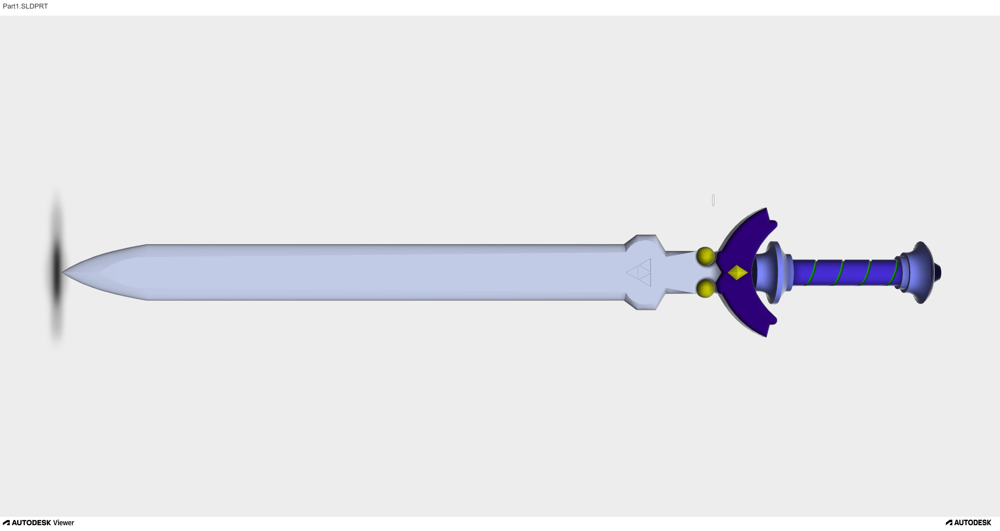
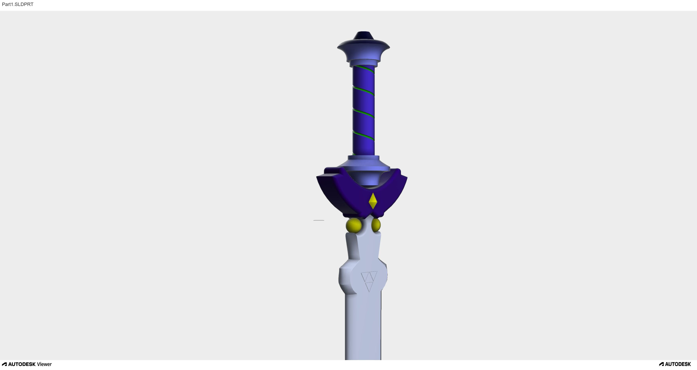

# 3D The Master Sword Model

## Overview

This project features a decorative 3D sword model created as a CAD modeling exercise.
The Master Sword
The design combines an elongated blade with a detailed handle and a decorative crossguard.

## Preview

## Details

## Design Features

- Elongated blade with a pointed tip
- Decorative crossguard
- Cylindrical handle with spiral detailing
- Rounded pommel and ornamental elements

## Tools

- **Project type:** 3D CAD modeling
- **Software:** CAD software used to create the model

## Project Files

- `images` — model previews
- `model` — original CAD files, if available
- `raport` — supporting documentation, if available

## Context

Part of my collection of university 3D modeling exercises.
